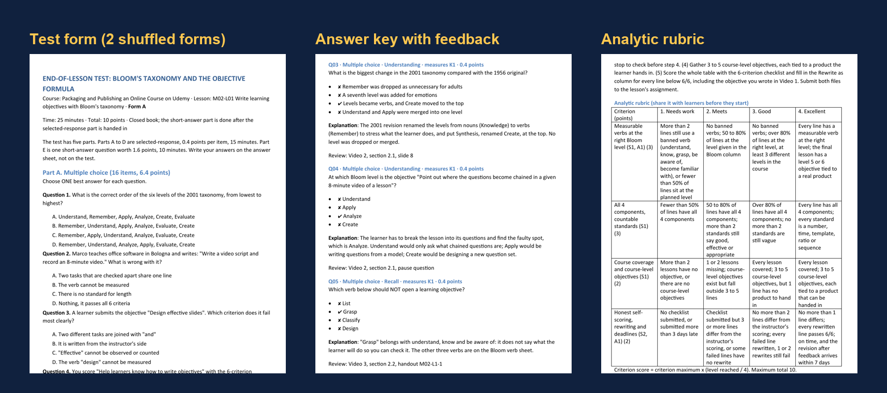

# Lesson Assessment Designer: a Claude Skill that writes quizzes, tests and rubrics from learning objectives

**Lesson Assessment Designer is an open-source Agent Skill for Claude that turns the learning objectives of one lesson into a complete assessment pack: a test blueprint (table of specifications) mapped to Bloom's taxonomy, multiple choice, true/false, matching, fill-in-the-blank and short-answer items checked against item-writing rules, two shuffled test forms with answer sheets, an answer key that explains every option, and a practical assignment with a checklist or analytic rubric for the skills a quiz cannot measure.**

You give Claude a lesson's objectives (and the lesson, if you have it). Claude decides what each objective needs, plans the blueprint, writes every item as data, and a Python script refuses to build the test until every objective is covered, every item has exactly one correct answer, no option says "all of the above", no true/false statement leans on "always" or "never", and the points add up. Then it builds the files in Markdown and Word, plus a Moodle GIFT file and a CSV.

It works in Claude Code, the Claude desktop and web apps, and the Claude Agent SDK. For classroom teachers, university lecturers, corporate trainers, vocational instructors and online course creators on Udemy, Teachable, Coursera, Thinkific, Moodle or any LMS. English and Vietnamese labels built in, items in any language. MIT licensed.



It is the fifth skill in a set for course creators:
- [Curriculum Designer](https://github.com/chuonglife/curriculum-designer-skill) designs the whole program.
- [Lesson Content Writer](https://github.com/chuonglife/lesson-content-writer-skill) writes each lesson and its measurable objectives.
- [Lesson Slide Designer](https://github.com/chuonglife/lesson-slide-designer-skill) turns each lesson into slides and a video script.
- [Lesson Video Producer](https://github.com/chuonglife/lesson-video-producer-skill) turns the slides into a narrated, animated lesson video.
- **Lesson Assessment Designer** writes the quiz, test and assignment for each lesson.

## Contents

- [What you get](#what-you-get)
- [Who it is for](#who-it-is-for)
- [Install](#install)
- [Use it](#use-it)
- [How the skill works](#how-the-skill-works)
- [The rules it enforces](#the-rules-it-enforces)
- [Example output](#example-output)
- [FAQ](#faq)
- [Repository layout](#repository-layout)
- [Sources and credits](#sources-and-credits)

## What you get

One folder per test:

| File | What it is |
|---|---|
| `assessment.json` | The single source: objectives, topics, items, assignments. Edit it and rebuild |
| `01_Test_Blueprint.md` | The table of specifications: topics x four cognitive levels (recall, understanding, routine application, higher-order), items, points and percentages per cell; which item or assignment measures each objective; the lesson's assessment plan |
| `02_Test_Form_A.md` / `B` + `.docx` | Learner copies, grouped in parts by item type, items and options shuffled differently in each form, answer keys spread evenly over A to D, with an answer sheet |
| `03_Answer_Key_and_Marking_Guide.md` + `.docx` | The key for each form; every item with why the answer is right and why each distractor is wrong; short-answer scoring points and a model answer; score conversion to 10 and to a percentage; grade bands; a facility list to fill in after marking |
| `04_Assignment_and_Rubric.md` + `.docx` | The assignment brief (task, deliverable, time, deadline, marker) and its checklist, criteria sheet or rubric, ready to share with learners before they start |
| `quiz.gift` | Moodle GIFT import, with feedback |
| `questions.csv` | One row per item, for spreadsheets and other LMS imports |
| `_check/check-report.md` | Every blocking error and warning the checks found |

An item in `assessment.json` looks like this:

```json
{
  "id": "Q14", "type": "mcq", "topic": "T2", "objective": "K2", "level": "apply", "points": 0.4,
  "stem": "Marco teaches office software in Bologna and writes: \"Write a video script and record an 8-minute video.\" What is wrong with it?",
  "options": ["Nothing, it passes all 6 criteria", "The verb cannot be measured",
              "Two tasks that are checked apart share one line", "There is no standard for length"],
  "answer": 2,
  "explanation": "The script is handed in first and the video later, each checked with a different tool, so they need two lines. The verbs and the 8-minute standard are fine.",
  "source": "Video 6, section 3.4"
}
```

## Who it is for

- **School teachers** who want a fair end-of-unit test without spending a Sunday on it.
- **University lecturers and teaching assistants** who need a table of specifications, parallel forms and a marking guide.
- **Online course creators** on Udemy, Teachable, Kajabi, Thinkific or Coursera who need a quiz after every section and an assignment with a rubric.
- **Corporate trainers and L&D teams** writing knowledge checks and on-the-job skill checklists.
- **Vocational and technical (TVET) instructors** who assess both knowledge and practical performance.
- **Instructional designers** who want assessment aligned to objectives (constructive alignment) by construction, not by hope.

## Install

**Claude Code (personal, all projects)**

```bash
git clone https://github.com/chuonglife/lesson-assessment-designer-skill ~/.claude/skills/lesson-assessment-designer
pip install -r ~/.claude/skills/lesson-assessment-designer/requirements.txt
```

**Claude Code (one project only)**

```bash
git clone https://github.com/chuonglife/lesson-assessment-designer-skill .claude/skills/lesson-assessment-designer
pip install -r .claude/skills/lesson-assessment-designer/requirements.txt
```

**Claude desktop or web app**

Download `lesson-assessment-designer.skill` from the [latest release](https://github.com/chuonglife/lesson-assessment-designer-skill/releases/latest) and add it under Settings, Capabilities, Skills.

**Requirements**: Python 3.8+. The checks, Markdown, GIFT and CSV use only the standard library; Word files need `python-docx` (installed by `requirements.txt`, or skip them with `--no-docx`).

## Use it

Ask in plain language. The skill triggers on requests for a quiz, test, exam, question bank, knowledge check, assignment, rubric or marking guide for a lesson.

```
Make the end-of-lesson quiz for lessons/support-onboarding/M03-L02.
10 questions, 80% to pass, and an assignment with a rubric for the skill objectives.
```

```
Here are the objectives of my Year 8 lesson on fractions. Write a 20-minute test
with a blueprint and two versions for the two rows of desks.
```

```
I teach a Udemy course on pricing coaching packages. This is the script of section 3.
Write a 6-question quiz with feedback for each answer, and a rubric for the pricing sheet they submit.
```

```
Soạn đề kiểm tra 15 phút cho bài này, tiếng Việt, có ma trận đề và đáp án.
```

If you only paste the lesson, the skill drafts measurable objectives first, lists them as assumptions, and builds the test on those. For a whole course, ask lesson by lesson.

## How the skill works

The six steps of writing a test with a blueprint, from teacher education practice:

1. **Set the purpose.** Diagnostic, formative or summative; that decides length, difficulty and the pass mark (written down with its reason).
2. **Fix the objectives and their levels.** Each objective gets a level (recall, understanding, routine application, higher-order) from its verb and standard, and a decision: measured by the test, by an assignment, or both. Skills such as "write", "design" or "carry out" go to the assignment, because recognising a good answer is not producing one. A standard such as "8 out of 10" sets the item count.
3. **Build the blueprint.** Topics x levels, points shared by teaching time and importance, every selected-response item worth the same.
4. **Write the items.** One objective per item, scenarios from the learners' own work, distractors taken from the real mistakes the lesson warns about, an explanation and a "review this section" pointer on every item.
5. **Key, scoring, assignment and rubric.** Points, conversion, grade bands; a checklist, criteria sheet, holistic or analytic rubric with countable descriptors.
6. **Review and build.** Claude takes the test as a learner, then `build_assessment.py` checks everything and builds the pack only when nothing blocks it.

## The rules it enforces

Blocking errors (no test is built until they are fixed):

- An objective that no item or assignment measures; an item that measures no objective.
- A multiple-choice item without exactly one key, with duplicate options, or with "all of the above", "none of the above" or "both A and B".
- True/false items worth more than 20% of the test, unbalanced true and false, or giveaway words (always, never, all, none, only, sometimes, usually, may).
- A matching item whose answer column is not longer than the prompt column, or that reuses an option.
- A fill-in-the-blank with no blank, more than two blanks, or a blank at the start.
- A short answer whose scoring points do not add up.
- Selected-response items worth different points; totals that do not match.
- An item two or more levels below the objective it claims to measure.
- A rubric without a descriptor for every level, or criteria that do not add up.
- No feedback explanation on a selected-response item; long dashes or stock AI phrases.

Warnings (built, flagged for a human decision): the correct option much longer than the distractors, one letter used for over 40% of keys or three in a row, negative stems not in capitals, fewer items than an objective's standard needs, rubric descriptors with nothing countable, and more.

## Example output

An end-of-lesson test for "Write learning objectives with Bloom's taxonomy", a lesson for teachers and trainers building their first online course (the same lesson used as the example in Lesson Content Writer and Lesson Slide Designer): [examples/M02-L01-write-objectives-with-blooms-taxonomy](examples/M02-L01-write-objectives-with-blooms-taxonomy)

- [01_Learning_Objectives.md](examples/M02-L01-write-objectives-with-blooms-taxonomy/01_Learning_Objectives.md), the input
- [assessment.json](examples/M02-L01-write-objectives-with-blooms-taxonomy/assessment.json), the source
- [01_Test_Blueprint.md](examples/M02-L01-write-objectives-with-blooms-taxonomy/01_Test_Blueprint.md), 22 items over 3 topics and 4 levels (24 / 32 / 28 / 16%)
- [02_Test_Form_A.md](examples/M02-L01-write-objectives-with-blooms-taxonomy/02_Test_Form_A.md) and [Form B](examples/M02-L01-write-objectives-with-blooms-taxonomy/02_Test_Form_B.md): 16 multiple choice, 3 true/false, 1 matching, 1 fill-in, 1 short answer; 25 minutes, 10 points, pass at 8
- [03_Answer_Key_and_Marking_Guide.md](examples/M02-L01-write-objectives-with-blooms-taxonomy/03_Answer_Key_and_Marking_Guide.md)
- [04_Assignment_and_Rubric.md](examples/M02-L01-write-objectives-with-blooms-taxonomy/04_Assignment_and_Rubric.md), a 4 x 4 analytic rubric for the objective table learners submit
- [quiz.gift](examples/M02-L01-write-objectives-with-blooms-taxonomy/quiz.gift) and [questions.csv](examples/M02-L01-write-objectives-with-blooms-taxonomy/questions.csv)

## FAQ

### What is a Claude Skill?

A Claude Skill (Agent Skill) is a folder with a `SKILL.md` file, reference documents and optional scripts. Claude loads it when a request matches the skill's description, then follows its instructions and runs its scripts. Skills run in Claude Code, the Claude apps and the Claude Agent SDK.

### How is this different from asking Claude to "write 10 quiz questions"?

A plain request gives you questions that look fine and test the wrong things: mostly recall, the correct option often the longest, "all of the above" as a crutch, distractors no one would pick, nothing about the skills the lesson promised. This skill starts from the objectives, plans a blueprint so every objective and level is covered in proportion, writes distractors from real learner mistakes, and runs a script that refuses to build the test while any item breaks a rule. Skill objectives get an assignment with a rubric instead of being forced into multiple choice.

### What is a test blueprint (table of specifications)?

A test blueprint is a two-way table with the topics of a lesson on one axis and cognitive levels on the other; each cell says which objective is tested there, with how many items and how many points. It keeps a test balanced: important topics get more items, and higher-order objectives are not quietly tested with recall questions.

### Does it use Bloom's taxonomy?

Yes. Objectives and items are placed on the revised Bloom's taxonomy (Remember, Understand, Apply, Analyse, Evaluate, Create), grouped into four blueprint columns: recall, understanding, routine application and higher-order application. Skills follow Dave's psychomotor levels and attitudes follow Krathwohl's affective levels; the reference file maps verbs to levels and to the item type or tool that fits each.

### Which question types does it write?

Multiple choice (one best answer, 3 or 4 options), true or false, matching (with extra options on the right), fill in the blank (up to two blanks, every accepted spelling listed) and short answer (with scoring points and a model answer). For skills it writes assignments marked with a checklist, a criteria sheet, a holistic rubric or an analytic rubric.

### Can I import the quiz into Moodle, Canvas, Google Forms or Udemy?

`quiz.gift` imports straight into Moodle (and other tools that read GIFT), with feedback for each question. `questions.csv` has one row per item for spreadsheets, Google Forms add-ons and other LMS importers. Udemy quizzes are entered question by question; the answer key gives you the explanation to paste for each one.

### Does it make different versions of the test?

Yes. Two forms by default (set `"forms"` for more): the same items, shuffled order within each part, shuffled options, with the correct letters spread so no letter dominates and no three keys in a row match. Each form has its own key.

### Can it write tests in other languages?

Items are written in the language of your request. Headings, instructions and the answer sheet come in English or Vietnamese (`"language": "en"` or `"vi"`); add a label set in the script for another language. The giveaway-word and stock-phrase checks cover English and Vietnamese.

### Do I need the other skills in the set?

No. Any list of objectives works, and if you have none the skill drafts them from your lesson. If you use [Lesson Content Writer](https://github.com/chuonglife/lesson-content-writer-skill), its `01_Learning_Objectives.md` (codes K1, S1, A1 and an alignment table) and its "common mistakes" sections feed this skill directly.

### Is it free?

Yes. MIT license.

## Repository layout

```
SKILL.md                                  instructions Claude follows
references/test-design-process.md         the six steps, blueprint templates, scoring, validity and reliability, using results
references/objective-levels-and-tools.md  Bloom, Dave and Krathwohl levels, verbs, and the item type or tool for each level
references/item-writing-rules.md          rules and examples for every item type, distractors from real mistakes, every check
references/skill-assessment-tools.md      checklists, criteria sheets, holistic and analytic rubrics, the assignment format
references/worked-example.md              the decisions behind the example test
scripts/build_assessment.py               assessment.json -> blueprint, forms, key, rubric, GIFT, CSV, with every check
templates/assessment.example.json         a complete test with all five item types and a rubric assignment
examples/                                 a built example: input objectives, source JSON and every output
assets/                                   README images
```

## Sources and credits

- Institute of Technical Education, Ho Chi Minh City University of Technology and Education, Module 06 *Assessment in teaching* (Đánh giá trong dạy học): Lesson 1, planning assessment; Lesson 2, designing assessment tools (written, oral and selected-response tests, checklists, criteria sheets, holistic and analytic rubrics); Lesson 3, analysing and using results; and the summary table of objective levels, verbs and assessment methods.
- Vietnam Ministry of Education and Training, guidance 8773/BGDĐT-GDTrH (30 December 2010) on writing tests with a blueprint; Dang Thi Dieu Hien (2014), lecture notes on assessment in education.
- Anderson, L. W. and Krathwohl, D. R. (eds.) (2001), *A Taxonomy for Learning, Teaching, and Assessing*, Longman.
- Dave, R. H. (1970/1975), psychomotor levels; Krathwohl, D. R., Bloom, B. S. and Masia, B. B. (1964/1973), *Taxonomy of Educational Objectives, Handbook II: Affective Domain*.

The skill was first written in Vietnamese by Chuong for his own production line of online courses for teachers and trainers, used on real lessons, then generalized and translated for public use.

## Contributing

Issues and pull requests are welcome, especially label sets and giveaway-word lists for more languages, and export formats for other platforms (QTI, Canvas, Kahoot).

## License

[MIT](LICENSE)
